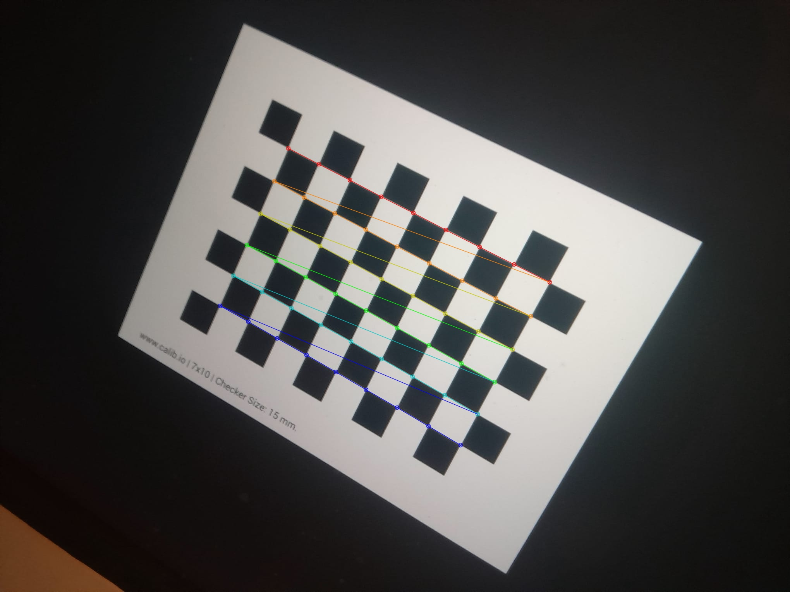
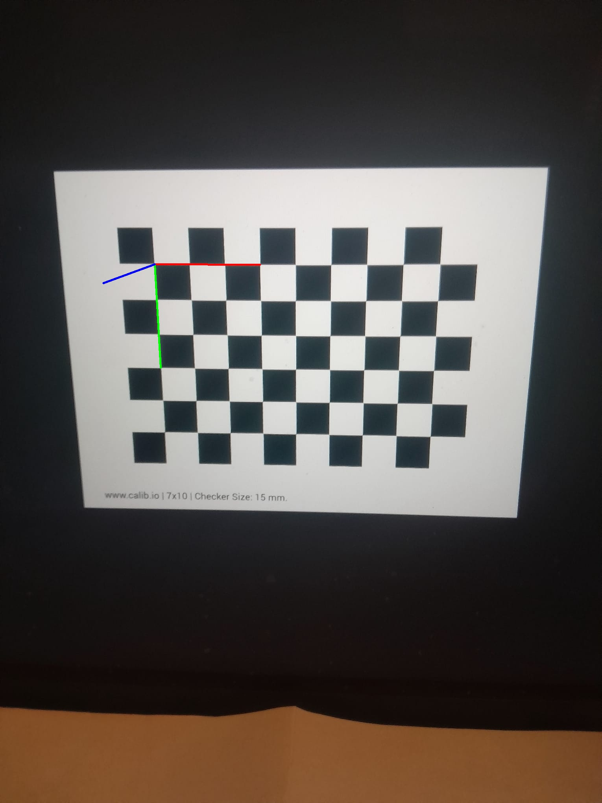

# 📷 Camera Calibration & 3D Pose Estimation (VMI 2026)

[](https://www.python.org/)
[](https://isocpp.org/)
[](https://cmake.org/)
[](https://opencv.org/)
[](https://opensource.org/licenses/MIT)

Projet pratique d'étalonnage géométrique de caméra (Pinhole Model) et d'estimation de pose 3D (Perspective-n-Point) réalisé dans le cadre du Master Vision et Machines Intelligentes (VMI 2026) à l'Université Paris Cité.

---

## Aperçu du Projet

L'objectif de ce projet est de caractériser les paramètres géométriques et optiques d'un capteur passif réel (caméra d'ordinateur/smartphone) à partir de clichés d'un motif planar (damier $9 \times 6$ coins internes) et de projeter un repère tridimensionnel en réalité augmentée.

### Fonctionnalités Principales :
* **Double Implémentation Native :** Disponible en **Python** (OpenCV) et en **C++17** (avec CMake pour la portabilité cross-platform).
* **Détection sub-pixellique :** Localisation automatique des intersections du damier (`cv2.findChessboardCorners` / `cv::findChessboardCorners` + affinement `cornerSubPix`).
* **Calibration matricielle :** Résolution du système par SVD/moindres carrés pour extraire la matrice intrinsèque $K$ et le vecteur de distorsion ($k_1, k_2, p_1, p_2, k_3$).
* **Extraction métrique :** Conversion des données pixelliques en grandeurs physiques réelles (longueur focale en mètres, champs de vision FOV $X/Y$) via `calibrationMatrixValues()`.
* **Estimation de Pose 3D (PnP) :** Calcul de la pose extrinsèque ($R, T$) et incrustation d'axes 3D virtuels (`solvePnP` + `projectPoints`).

---

## Cadre Théorique & Formulations

La projection d'un point du monde réel $P^{(W)} = [X, Y, Z, 1]^T$ vers un pixel image $p^{(I)} = [u, v, 1]^T$ s'exprime par :

$$p^{(I)} = M_{\text{int}} \cdot M_{\text{ext}} \cdot P^{(W)}$$

Où la matrice intrinsèque $M_{\text{int}}$ est donnée par :

$$M_{\text{int}} = \begin{bmatrix} f_x & 0 & O_x \\ 0 & f_y & O_y \\ 0 & 0 & 1 \end{bmatrix}$$

---

## Structure du Dépôt

```text
camera-calibration-3d-pose/
├── CMakeLists.txt              # Configuration CMake pour la compilation C++
├── data/
│   ├── images_calibration/     # Dataset (19 clichés du damier 9x6)
│   └── output/                 # Visualisations 3D & coins détectés
├── src/
│   ├── calibration.py          # Pipeline Python
│   └── calibration.cpp         # Pipeline C++17
├── docs/
│   └── calibration_Fallou_Diouf_VMI2026.pdf  # Rapport LaTeX du TP
├── README.md                   # Documentation du projet
└── requirements.txt            # Dépendances Python
```
---

## Installation & Exécution

### Version Python

1. **Installer les dépendances :**
   ```bash
   pip install -r requirements.txt
   ```

2. **Lancer la calibration :**
   ```bash
   python src/calibration.py
   ```

---

### Version C++ (C++17 & CMake)

1. **Prérequis (macOS via Homebrew) :**
   ```bash
   brew install cmake opencv
   ```

2. **Compiler et exécuter :**
   ```bash
   mkdir build && cd build
   cmake ..
   make
   ./calibration_cpp
   ```

---

## Résultats Obtenus

Les deux implémentations (Python et C++) fournissent des résultats parfaitement concordants sur l'ensemble du dataset ($100\%$ de détection sur 19 images).

| Paramètre / Métrique | Version Python | Version C++17 |
| :--- | :--- | :--- |
| **Images Validées** | **19 / 19** ($100\%$) | **19 / 19** ($100\%$) |
| **Erreur de Rétroprojection (RMS)** | **2.4210 pixels** | **2.42099 pixels** |
| **Longueur Focale Physique ($f$)** | **4.79 mm** ($0.004789\text{ m}$) | **4.78863 mm** ($0.00478863\text{ m}$) |
| **Focales Pixelliques ($f_x, f_y$)** | $1526.38\text{ px} \quad / \quad 1547.41\text{ px}$ | $1526.38\text{ px} \quad / \quad 1547.41\text{ px}$ |
| **Point Principal $(O_x, O_y)$** | $(1070.38, 794.51)\text{ pixels}$ | $(1070.38, 794.51)\text{ pixels}$ |
| **Champs de Vision (FOV)** | H: $51.80^\circ$ — V: $66.01^\circ$ | H: $51.798^\circ$ — V: $66.008^\circ$ |
| **Rapport d'Aspect (Aspect Ratio)** | **1.0138** | **1.01378** |

### Matrice Intrinsèque ($K$) Réelle :

$$K = \begin{bmatrix} 1526.38 & 0 & 1070.38 \\ 0 & 1547.41 & 794.51 \\ 0 & 0 & 1 \end{bmatrix}$$

### Coefficients de Distorsion :

$$[k_1, k_2, p_1, p_2, k_3] = [0.1088, -0.5957, 0.0156, 0.0216, 1.0892]$$

---

## Visualisations

### 1. Détection des Coins Sub-pixelliques ($9 \times 6$)


### 2. Projection d'un Repère 3D en Réalité Augmentée (PnP)
| Projection Python | Projection C++17 |
| :---: | :---: |
|  |  |

---
