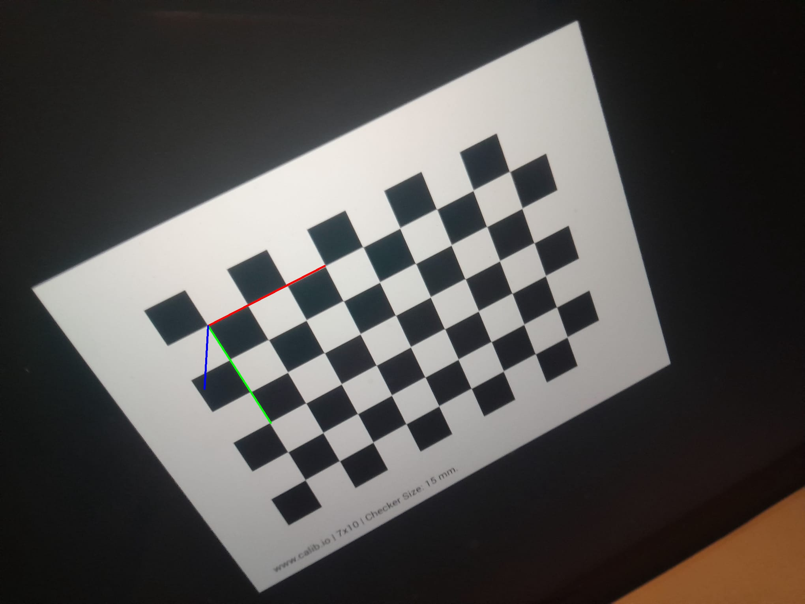

# 📷 Camera Calibration & 3D Pose Estimation (VMI 2026)

[](https://www.python.org/)
[](https://opencv.org/)
[](https://opensource.org/licenses/MIT)

Projet pratique d'étalonnage géométrique de caméra (Pinhole Model) et d'estimation de pose 3D (Perspective-n-Point) réalisé dans le cadre du Master Vision et Machines Intelligentes (VMI) à l'Université Paris Cité.

---

## 📌 Aperçu du Projet

L'objectif de ce projet est de caractériser les paramètres géométriques et optiques d'un capteur passif réel (caméra d'ordinateur/smartphone) à partir de clichés d'un motif planar (damier $9 \times 6$ coins internes) et de projeter un repère tridimensionnel en réalité augmentée.

### ✨ Fonctionnalités Principales :
* **Détection sub-pixellique :** Localisation automatique des intersections du damier (`cv2.findChessboardCorners` + `cv2.cornerSubPix`).
* **Calibration matricielle :** Résolution du système par SVD/moindres carrés pour extraire la matrice intrinsèque $K$ et le vecteur de distorsion ($k_1, k_2, p_1, p_2, k_3$).
* **Extraction métrique :** Conversion des données pixelliques en grandeurs physiques réelles (longueur focale en mètres, champs de vision FOV $X/Y$) via `cv2.calibrationMatrixValues()`.
* **Estimation de Pose 3D (PnP) :** Calcul de la pose extrinsèque ($R, T$) et incrustation d'axes 3D virtuels (`cv2.solvePnP` + `cv2.projectPoints`).

---

## 📐 Cadre Théorique & Formulations

La projection d'un point du monde réel $P^{(W)} = [X, Y, Z, 1]^T$ vers un pixel image $p^{(I)} = [u, v, 1]^T$ s'exprime par :

$$p^{(I)} = M_{\text{int}} \cdot M_{\text{ext}} \cdot P^{(W)}$$

Où la matrice intrinsèque $M_{\text{int}}$ est donnée par :

$$M_{\text{int}} = \begin{bmatrix} f_x & 0 & O_x \\ 0 & f_y & O_y \\ 0 & 0 & 1 \end{bmatrix}$$

---

## 📂 Structure du Dépôt

```text
camera-calibration-3d-pose/
├── data/
│   ├── images/              # Jeu de données (clichés du damier)
│   └── output/              # Résultats visuels (pose 3D projetée)
├── src/
│   └── calibration.py       # Pipeline complet Python OpenCV
├── docs/
│   └── rapport.pdf          # Rapport détaillé du TP (LaTeX)
├── README.md                # Documentation du projet
└── requirements.txt         # Dépendances Python
```
---

## Installation & Exécution

1. Prérequis & Dépendances
Assurez-vous de disposer de Python 3.8+ puis installez les bibliothèques requises :

```bash
pip install -r requirements.txt
``` 
2. Lancement du Pipeline de Calibration

Exécutez le script principal depuis la racine du projet :

```bash
python src/calibration.py
``` 
## Visualisation de la Pose 3D (Réalité Augmentée) :
Une fois le capteur étalonné, un repère orthonormé 3D [X,Y,Z] (Rouge, Vert, Bleu) est projeté sur l'origine du damier

## 📊 Résultats Obtenus

| Paramètre / Métrique | Valeur Calculée |
| :--- | :--- |
| **Images Validées** | **19 / 19** ($100\%$) |
| **Erreur de Rétroprojection (RMS)** | **2.4210 pixels** |
| **Longueur Focale Physique ($f$)** | **4.79 mm** ($0.004789\text{ m}$) |
| **Focales Pixelliques ($f_x, f_y$)** | $1526.38\text{ px} \quad / \quad 1547.41\text{ px}$ |
| **Point Principal $(O_x, O_y)$** | $(1070.38, 794.51)\text{ pixels}$ |
| **Champs de Vision (FOV)** | Horizontal: $51.80^\circ$ — Vertical: $66.01^\circ$ |
| **Rapport d'Aspect (Aspect Ratio)** | **1.0138** |

### Matrice Intrinsèque ($K$) Réelle :

$$K = \begin{bmatrix} 1526.38 & 0 & 1070.38 \\ 0 & 1547.41 & 794.51 \\ 0 & 0 & 1 \end{bmatrix}$$

### Coefficients de Distorsion :

$$[k_1, k_2, p_1, p_2, k_3] = [0.1088, -0.5957, 0.0156, 0.0216, 1.0892]$$

### Visualisation de la Pose 3D (Réalité Augmentée) :


### Photos avec le damier coloré
